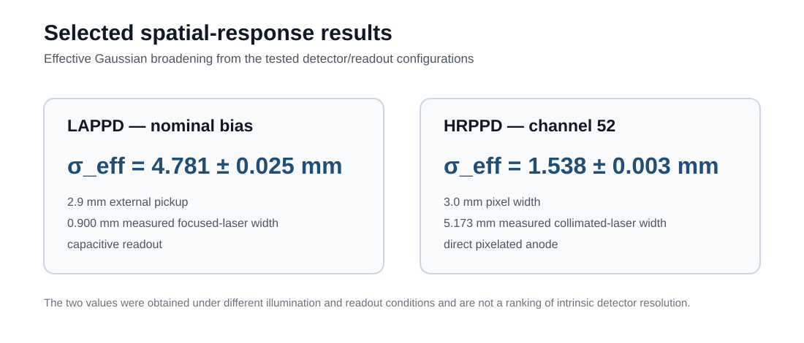
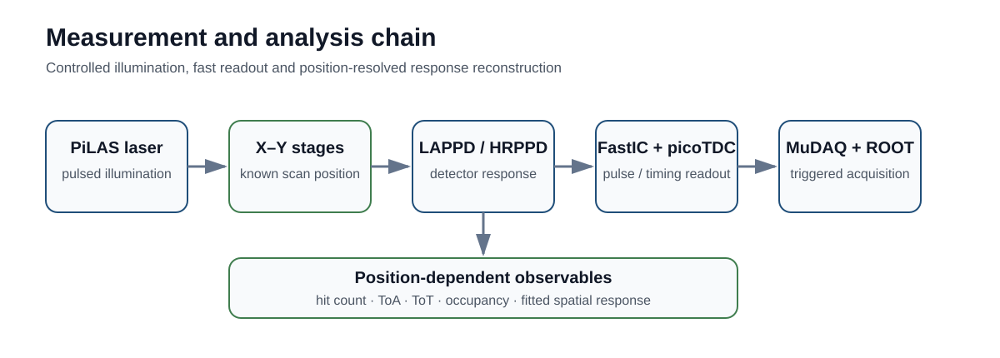
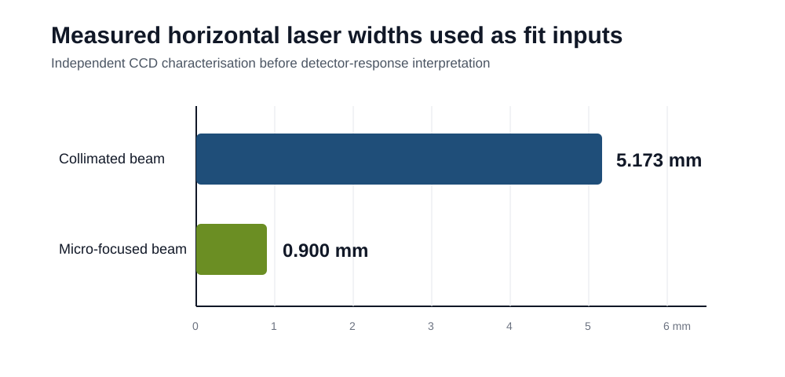
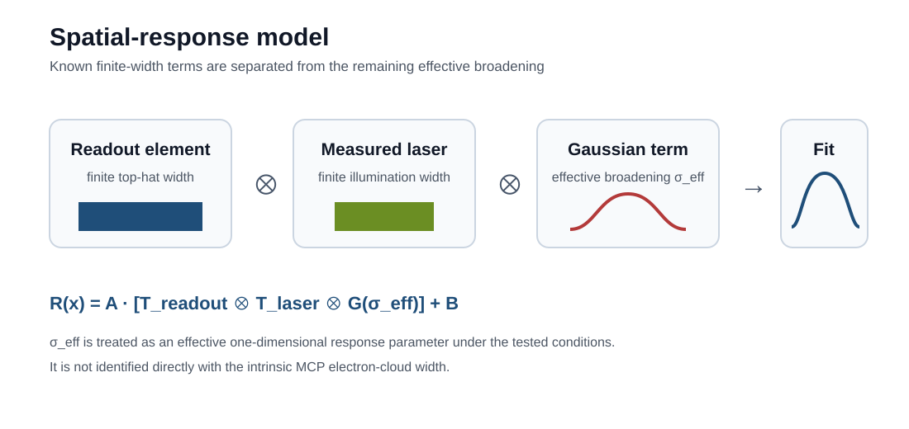
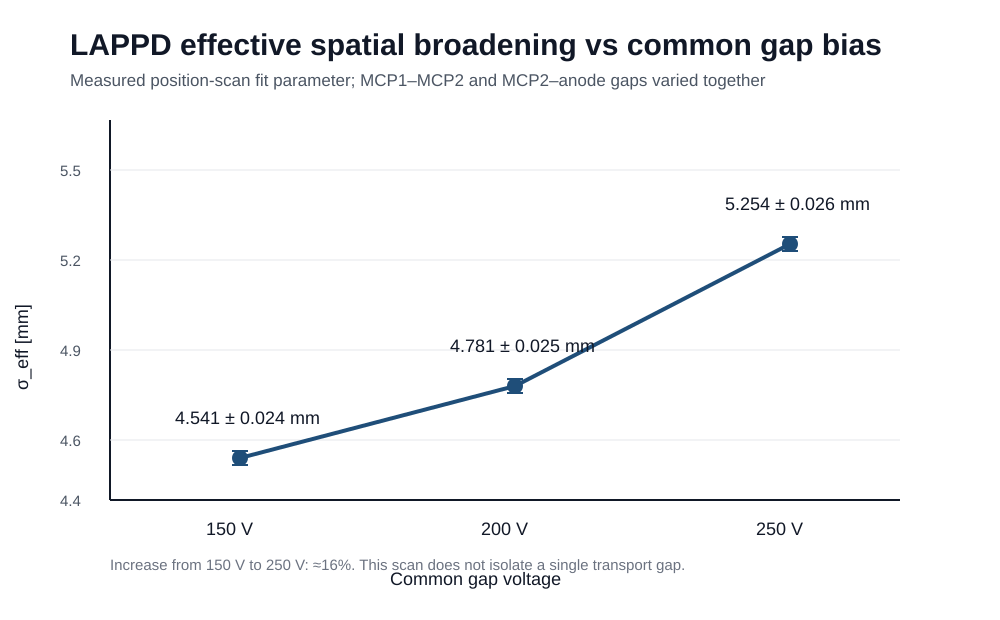

# MCP-Based Photon Detector Characterisation for the LHCb RICH Upgrade II

**Saqib Umair** · MSc Particle and Nuclear Physics · University of Edinburgh  
Supervisors: **Dr Silvia Gambetta** and **Dr Dan Foulds-Holt**  
Dissertation submitted: **21 August 2026**

This repository is a concise public record of my MSc detector-R&D project. I characterised the spatial response of a Gen-II Large Area Picosecond Photodetector (LAPPD) and a High-Rate Picosecond Photodetector (HRPPD) using controlled laser position scans, independent CCD measurements of the laser profile, and convolution-based response modelling.

> **Research question:** how do illumination width, readout geometry and operating conditions shape the measured spatial response of MCP-based photon detectors relevant to the LHCb RICH Upgrade II?

## Results at a glance

  

| Measurement | Result |
|---|---:|
| LAPPD, nominal bias | **σ_eff = 4.781 ± 0.025 mm** |
| LAPPD, common gap bias 150 → 250 V | **4.541 ± 0.024 → 5.254 ± 0.026 mm** |
| HRPPD, channel 52 | **σ_eff = 1.538 ± 0.003 mm** |
| Focused-laser horizontal width used in LAPPD fit | **0.900 mm** |
| Collimated-laser horizontal width used in HRPPD fit | **5.173 mm** |

The LAPPD and HRPPD measurements were made with different illumination and readout configurations. The fitted values are therefore not presented as a direct ranking of intrinsic detector resolution.

## Experimental and analysis workflow

  

A pulsed PiLAS laser was translated across the fixed detector using motorised stages. FastIC front-end electronics and picoTDC timing readout were used with MuDAQ-based triggered acquisition. The principal observables were hit count, time of arrival (ToA), time over threshold (ToT) and occupancy.

The finite laser profile was measured independently with a CCD camera before interpreting the detector scans.

  

## Spatial-response model

The measured scan width contains more than the detector response alone. I therefore treated the finite readout width and measured laser width explicitly and fitted an additional Gaussian broadening term.

  

The fitted **σ_eff** is an effective one-dimensional broadening parameter for the complete tested detector/readout configuration. It is not interpreted as a direct measurement of the intrinsic MCP electron-cloud width.

## LAPPD bias study

For the LAPPD scans, the external pickup width was fixed at **2.9 mm** and the measured micro-focused horizontal laser width at **0.900 mm**.

The common MCP1–MCP2 and MCP2–anode gap voltage was varied from 150 V to 250 V:

| Common gap voltage | σ_eff |
|---:|---:|
| 150 V | 4.541 ± 0.024 mm |
| 200 V | 4.781 ± 0.025 mm |
| 250 V | 5.254 ± 0.026 mm |

  

The fitted width increased by approximately **16%** from the low- to high-bias setting. Because the MCP1–MCP2 and MCP2–anode gaps were varied together, this result describes the complete tested bias configuration and does not isolate a single transport gap.

The simple symmetric model also does not reproduce all shoulder and tail structure. I therefore use σ_eff as a comparative response parameter rather than as a complete microscopic description.

## HRPPD spatial response

For HRPPD channel 52, the fit included the **3.0 mm pixel width** and the independently measured **5.173 mm collimated-laser width**. The additional fitted broadening was:

**σ_eff = 1.538 ± 0.003 mm**

As with the LAPPD result, this parameter describes the measured configuration and can include detector transport, readout, threshold and model-shape contributions.

## My contribution

I carried out the dissertation-level experimental analysis and software work, including:

- laser-profile characterisation from CCD measurements;
- motorised translation-stage control for position scans;
- ROOT/C++ and Python analysis for detector scans;
- convolution-based spatial-response fitting;
- LAPPD bias-dependence, occupancy and timing checks;
- HRPPD position-response analysis and exploratory neighbouring-channel signal-sharing studies.

## Technical scope

**Instrumentation:** MCP-based photon detectors, LAPPD, HRPPD, PiLAS laser, CCD beam profiling, motorised stages, FastIC, picoTDC, MuDAQ  
**Analysis:** ROOT/C++, Python, NumPy, SciPy, Matplotlib, uproot, nonlinear fitting, convolution models, ToA/ToT, detector-response interpretation

## Repository contents

- [Methodology](docs/METHODOLOGY.md) — measurement strategy and response model
- [Results and limitations](docs/RESULTS_AND_LIMITATIONS.md) — numerical results and fit limitations
- [Data and attribution](docs/DATA_AND_ATTRIBUTION.md) — what is and is not distributed publicly
- [Citation metadata](CITATION.cff)

## Data and code availability

Raw detector data, collaborator-provided decoding software, internal collaboration material and the working analysis source code are not distributed in this public repository. The public record is restricted to selected analysis outputs, methodology and results whose provenance is clear.
