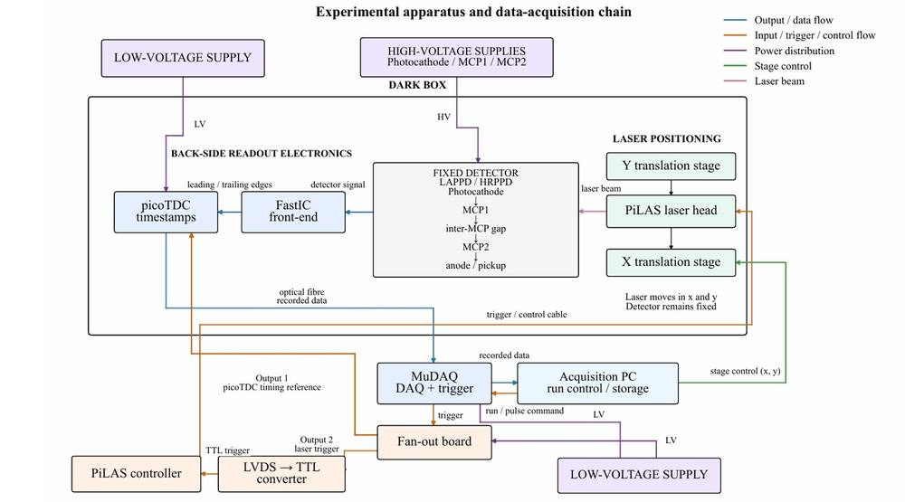
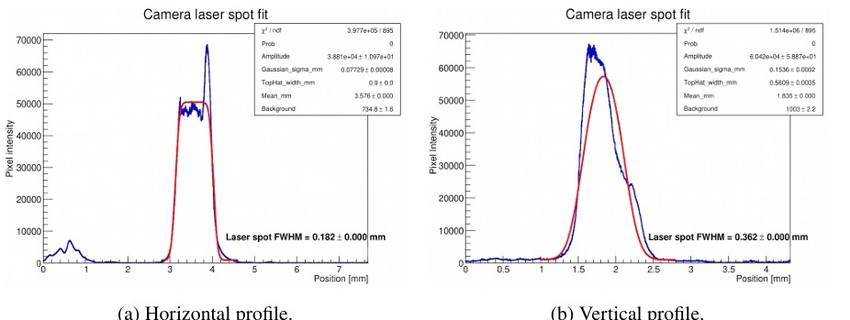
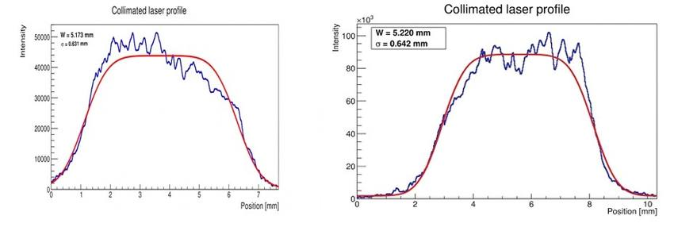
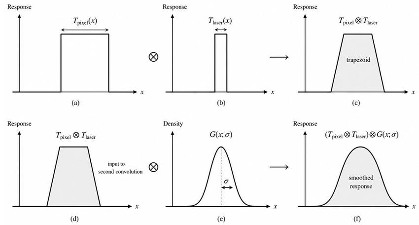
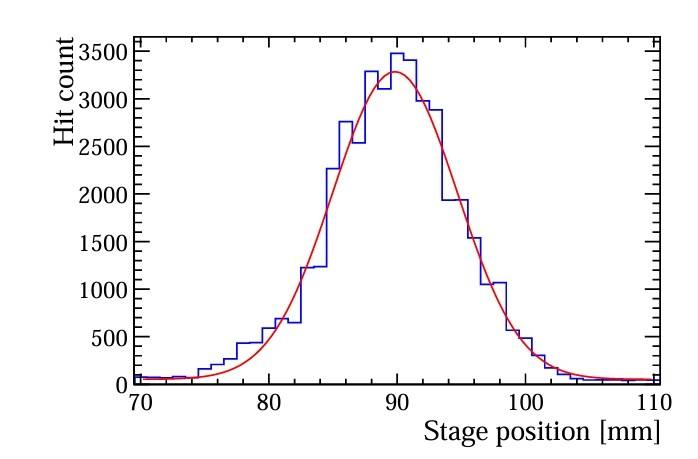
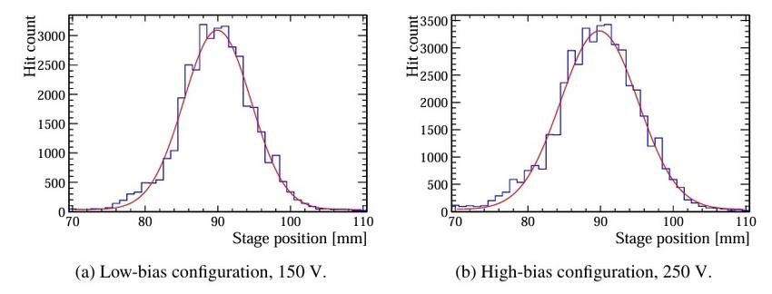
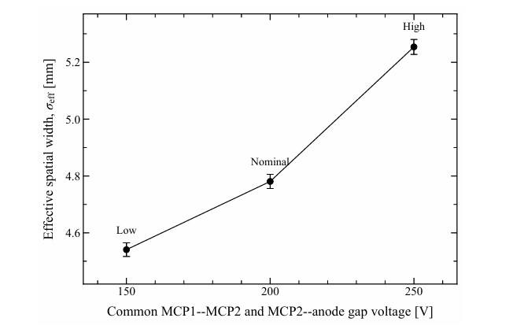
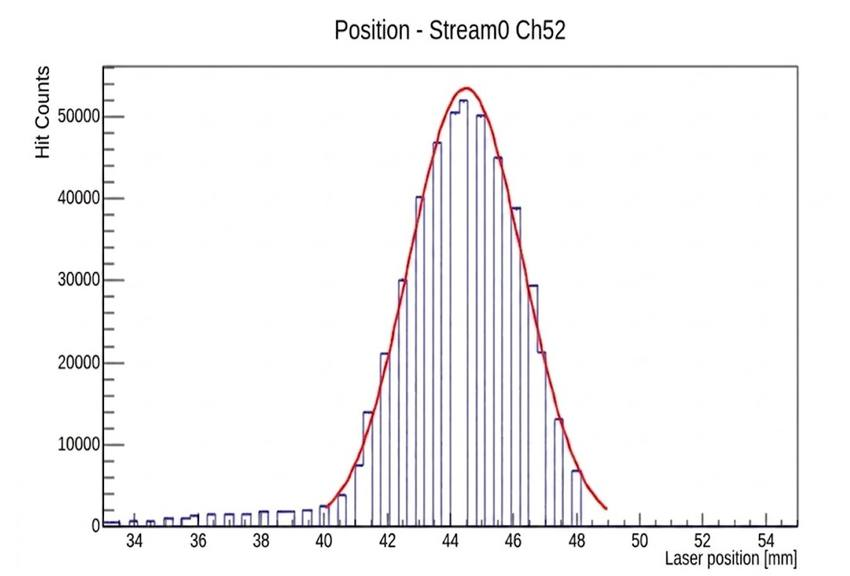

# Characterisation of MCP-Based Photon Detectors for the LHCb RICH Upgrade II

**Saqib Umair**  
MSc Particle and Nuclear Physics, University of Edinburgh  
Supervisors: **Dr Silvia Gambetta** and **Dr Dan Foulds-Holt**  
Dissertation submitted: **21 August 2026**

This repository presents selected results from my MSc research on the spatial response of microchannel-plate photon detectors for the LHCb RICH Upgrade II. I studied a Gen-II Large Area Picosecond Photodetector (LAPPD) and a High-Rate Picosecond Photodetector (HRPPD) using controlled laser position scans and independently measured laser profiles.

The main question was:

> How do illumination width, readout geometry and detector operating conditions affect the measured spatial response?

## Main results

| Measurement | Result |
|---|---:|
| LAPPD, nominal bias | **σ_eff = 4.781 ± 0.025 mm** |
| LAPPD, common gap bias 150 V | **4.541 ± 0.024 mm** |
| LAPPD, common gap bias 200 V | **4.781 ± 0.025 mm** |
| LAPPD, common gap bias 250 V | **5.254 ± 0.026 mm** |
| HRPPD, channel 52 | **σ_eff = 1.538 ± 0.003 mm** |

The LAPPD effective width increased by approximately **16%** between the 150 V and 250 V common-gap configurations.

The LAPPD and HRPPD values were obtained with different illumination and readout configurations, so they are not presented as a direct ranking of intrinsic detector spatial resolution.

## Experimental method

A pulsed PiLAS laser was translated across a stationary detector using motorised x-y stages. Detector signals were processed with FastIC front-end electronics and picoTDC timing readout, with MuDAQ used for triggered acquisition.

  

The principal observables were hit count, time of arrival (ToA), time over threshold (ToT) and occupancy.

Before interpreting the detector scans, I measured the transverse laser profile independently with a CCD camera.

## Laser characterisation

Two illumination configurations were used in the principal analyses:

- **LAPPD:** micro-focused horizontal laser width, **W_x = 0.900 mm**
- **HRPPD:** collimated horizontal laser width, **W_x = 5.173 mm**

### Micro-focused illumination

  

The focused spot was not spatially uniform. The horizontal profile was more stable under changes of profile position and fit range, so the horizontal measurement was used as the finite-width input to the principal LAPPD analysis.

### Collimated illumination

  

The measured horizontal collimated profile used in the HRPPD analysis gave **W_x = 5.173 mm** with a Gaussian component **σ_x = 0.631 mm**.

## Spatial-response model

The measured scan profile contains contributions from the finite readout width, finite laser width and additional detector/readout broadening.

  

The response was modelled schematically as

**R(x) = A · [T_readout ⊗ T_laser ⊗ G(σ_eff)] + B**

where ⊗ denotes convolution in position.

The fitted **σ_eff** is treated as an effective one-dimensional response parameter for the complete tested configuration. It is not identified directly with the intrinsic MCP electron-cloud width.

## LAPPD spatial response

For the LAPPD scans, the external pickup width was fixed at **2.9 mm** and the measured focused-laser width at **0.900 mm**.

At nominal bias:

**σ_eff = 4.781 ± 0.025 mm**

  

### Bias dependence

The MCP1-MCP2 and MCP2-anode gap voltages were changed together from 150 V to 250 V.

  

| Common gap voltage | σ_eff |
|---:|---:|
| 150 V | 4.541 ± 0.024 mm |
| 200 V | 4.781 ± 0.025 mm |
| 250 V | 5.254 ± 0.026 mm |

  

The fitted width increased by approximately **16%** from the low- to high-bias configuration.

Because the two transport gaps were varied simultaneously, this measurement does not identify which individual gap is responsible for the observed trend. The simple symmetric convolution also does not reproduce all shoulder and tail structure, so the large χ²/ndf values are treated as a limitation of the model rather than omitted.

## HRPPD spatial response

For HRPPD channel 52, the fit included the **3.0 mm pixel width** and the measured **5.173 mm collimated-laser width**.

The fitted additional broadening was:

**σ_eff = 1.538 ± 0.003 mm**

  

This result is interpreted as an effective response parameter under the tested conditions.

## My contribution

My dissertation work included:

- laser-profile characterisation from CCD measurements;
- motorised translation-stage control for position scans;
- ROOT/C++ and Python analysis of detector scans;
- convolution-based spatial-response fitting;
- LAPPD bias-dependence, occupancy and timing checks;
- HRPPD position-response analysis;
- exploratory neighbouring-channel signal-sharing studies.

## Technical tools

**Detector and DAQ:** LAPPD, HRPPD, PiLAS laser, CCD beam profiling, motorised stages, FastIC, picoTDC, MuDAQ  
**Analysis:** ROOT/C++, Python, NumPy, SciPy, Matplotlib, uproot, nonlinear fitting, ToA/ToT analysis

## Further information

- [Research summary](docs/PROJECT_SUMMARY.md)
- [Methodology](docs/METHODOLOGY.md)
- [Results and limitations](docs/RESULTS_AND_LIMITATIONS.md)
- [Data and attribution](docs/DATA_AND_ATTRIBUTION.md)
- [Citation metadata](CITATION.cff)

## Public repository scope

The full dissertation is **not published in this repository**.

Raw detector data, collaborator-provided decoding software, internal collaboration material and the working analysis source code are also not distributed publicly. The repository is limited to selected research outputs, methodology, results and figures suitable for public release.
